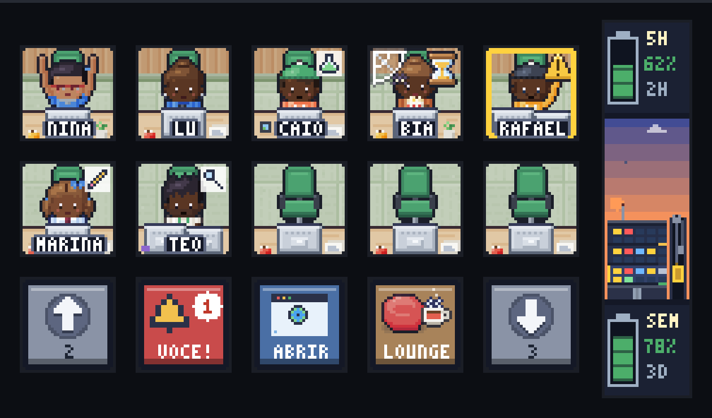
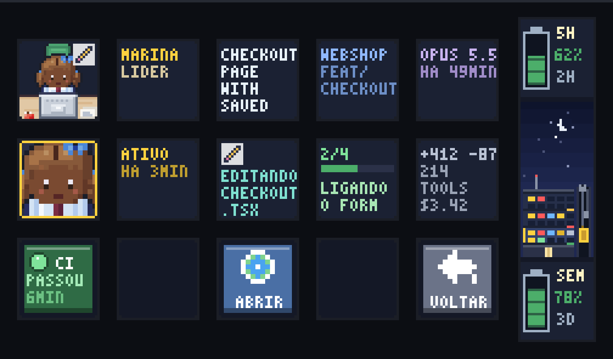
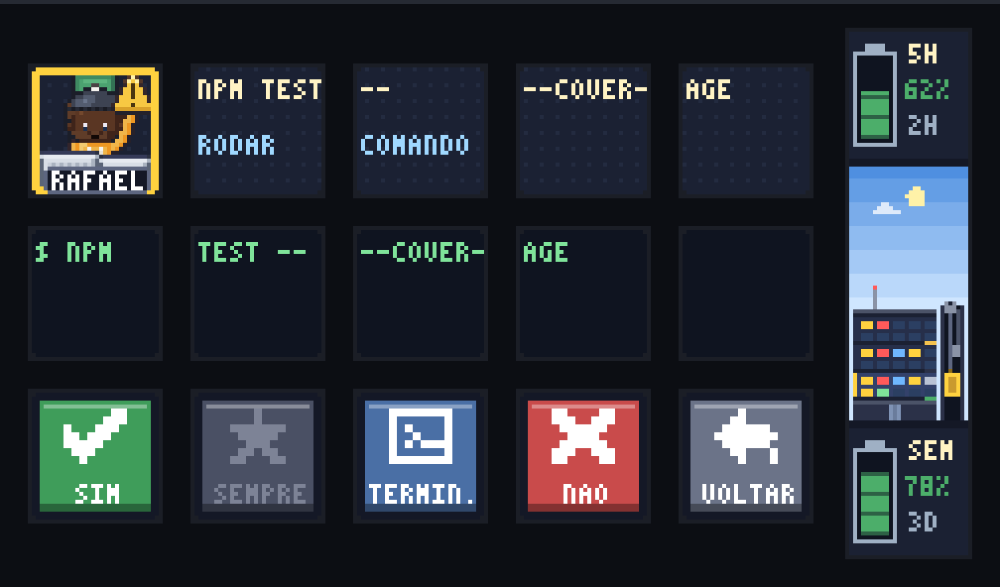
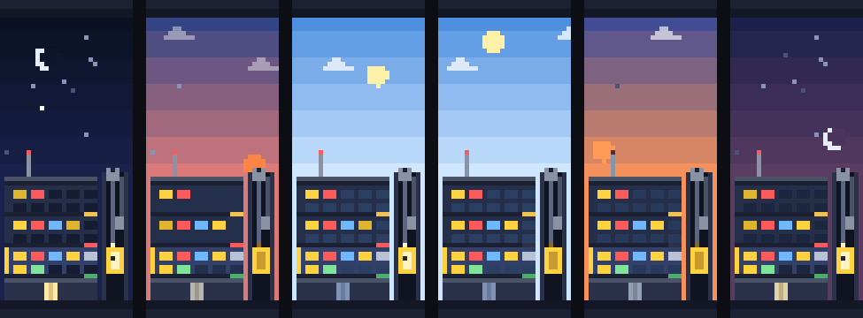

# Habblaud Deck

**Your Claude Code sessions as a tiny pixel-art office, live on a stream deck.**

Habblaud Deck puts [Habblaud](https://github.com/marmottajr/habblaud)'s office on a **Rise Mode Vision 01** (a rebranded
Mirabox 293S V3): 15 LCD keys and a side strip, driven directly over USB HID by a small Node daemon. Every agent sits at
a desk on its own key, the strip shows your usage limits and a building with one floor per project, and you can answer
permission requests without leaving what you're doing.



The characters and furniture are drawn by **Habblaud's own art code** (pure TypeScript), so every agent looks exactly
like it does in the browser.

## What's on the deck

**The office (top 10 keys).** One workstation per key, drawn as one continuous room seen through the key windows. Each
agent shows what it's doing: typing with an activity badge (read, edit, run, test, git, web…), popcorn and an hourglass
while a shell runs, cobwebs after a while, asleep when idle for long, and a hand up with a blinking frame when it needs
you. Names sit on little desk plates.

**Press an agent** to open its card: one fact per key, each in its own colour, and text never runs across keys.



| key | shows |
|---|---|
| name | name and role (lead or subagent type) |
| title | what the session is about (scrolls when long) |
| project | project folder and git branch |
| model | model and time since the session started |
| status | working / needs you / running a shell / idle / done, and for how long |
| activity | current tool with its icon, plus the file or command |
| tasks | done/total, a progress bar and the current task |
| numbers | lines added/removed, tool calls, cost or tokens |
| **CI** | GitHub Actions result for that branch; press it to open the run |

**Permission requests** come to the deck: the request on the top rows and **Yes / Always / Terminal / No / Back** on the
bottom row. AskUserQuestion options become keys you can press.



**The bottom row.** ▲ ▼ ride the elevator between project floors (doors close across the deck and the car slides along
the strip); 🔔 counts the agents that need you and jumps straight to the oldest; 🌐 opens Habblaud in the browser;
**lounge** shows the idle agents playing ping-pong and having coffee, and turns into an **office** button to get back.
Every button has its own small idle animation.

**Hold an agent** for 0.6 s to open Habblaud in the browser on that agent.

**Events.** A merged PR or a release throws confetti over all 18 tiles; a red CI run sets off beacons in that room.

### The strip

Between the 5-hour and weekly usage batteries stands the building: one floor per project, with **10 windows per floor,
one per seat**, lit in the colour of whoever sits there (yellow working, blinking red needs you, blue running a shell,
grey idle, green done). Each floor has a CI lamp, and the elevator car follows the floor shown on the keys, with a
spinning pulley, a counterweight and a "ding" when it rests.

The sky follows your local time:



## Setup (Windows)

Needs Node.js 22.12+ and Git. The deck expects Habblaud checked out next to it (`dev\habblaud` and
`dev\habblaud-deck` side by side); the setup script does that for you.

```powershell
powershell -ExecutionPolicy Bypass -File .\setup.ps1   # clones ..\habblaud, builds it, installs its Claude Code mod
powershell -ExecutionPolicy Bypass -File .\start.ps1   # Habblaud + deck + simulator (http://localhost:4748)
powershell -ExecutionPolicy Bypass -File .\start.ps1 -Sim   # simulator only, no hardware
```

**Close the Rise Mode / Mirabox app first** (tray icon → Exit): it holds the device.

The simulator at http://localhost:4748 mirrors the deck in the browser. You can click keys, tune the gaps between keys,
and use it without the hardware. It costs nothing while no browser has it open.

### CI status

The CI lights read GitHub Actions for each project folder's `origin` remote, on the agent's branch (or the folder's
current branch). The deck uses, in order:

1. `GITHUB_TOKEN`, if set;
2. the GitHub login git already stores (Git Credential Manager, the one `git push` uses), so private repos work with no
   setup;
3. no login at all: public repos only.

It checks every one to two minutes (faster while a run is in progress), and unchanged answers don't count against
GitHub's rate limit.

## Commands

| command | what |
|---|---|
| `npm start` | daemon: Habblaud → deck + simulator |
| `npm run sim` | simulator only |
| `npm run calibrate` | check orientation and key order (press the keys from the top-left, row by row) |
| `npm run probe -- list [all]` | HID devices that look like the deck (`all`: every HID device) |
| `npm run probe -- panel \| inputs \| strip-tiles \| raw \| no-keepalive` | protocol experiments |
| `npm run readme-images` | re-render the pictures in `docs/` |
| `npm run typecheck` | `tsc --noEmit` |

Environment: `HABBLAUD_URL` (default `http://localhost:4747`), `DECK_SIM_PORT` (default `4748`), `GITHUB_TOKEN`
(optional).

## The hardware

`deck.config.json` is calibrated for the Rise Mode Vision 01:

```json
{
  "vendorId": 2560,
  "productId": 4102,
  "keyRotation": 270,
  "stripRotation": 270,
  "keyMap": [13, 10, 7, 4, 1, 14, 11, 8, 5, 2, 15, 12, 9, 6, 3],
  "stripMap": [16, 17, 18],
  "keyCut": [-3, 0, 36, 36],
  "stripGap": 18
}
```

What was measured, from photos of test patterns:

- **USB.** `0A00:1006`, "HOTSPOTEKUSB HID DEMO". Interface 0 is the vendor one (usage page `0xFFA0`, 1025-byte output
  reports = report id 0 + 1024 bytes, 513-byte input); interface 1 is a keyboard and is ignored.
- **Orientation.** The panel is natively portrait: every image shows rotated 90° clockwise, so tiles are pre-rotated 270°.
- **Key order.** Device index 1 is the top-right key, numbered down each column, then the next column to the left. Key
  presses report the same indexes.
- **Key windows.** About 104×98 px of a tile shows through each key, anchored at the tile's top-right. Tiles are
  108×108 px, cut from the scene starting 3 art px left of the key (`keyCut`), so the key's art sits centred and the
  room continues into the frame.
- **Strip.** One continuous screen about 90 px wide. The three strip tiles start level with the three key rows, about
  150 px apart, and each covers its slot plus the space below it, so the strip reads as one picture. The bottom tile is
  at most 120 px tall: a taller one is moved up by the device and overlaps the middle one.
- **Speed.** A full 18-tile frame takes about 120 ms; normal frames only resend the tiles that changed.

### Protocol

1024-byte writes, each command `CRT\0\0` + an ASCII opcode:

- init: `DIS`, `LIG` + brightness, `QUCMD 11 11 00 11 00 11`, `CLE 00 00 00 ff`;
- image: `CRT\0\0BAT` + size (4 bytes, big-endian) + tile index, then the JPEG in raw 1024-byte chunks, then `STP`.
  There is **no padding after `BAT`**: two extra zero bytes there make the device silently drop the image;
- keep-alive: `CONNECT` every 10 s;
- input: 512-byte reports `ACK\0\0OK\0\0` + key index + state (`01` down, `00` up).

Tile indexes are 1–15 for the keys and 16–18 for the strip. JPEGs can be baseline 4:4:4 or 4:2:0, any size from 85 to
120 px, drawn unscaled. **Keep tiles small:** very busy ~15 KB tiles sent back to back froze the firmware (writes time out
with `0x3E5` and the deck needs a replug). The driver re-encodes any tile over 8 KB at lower quality and reconnects
after a failed write; real office tiles are about 5 KB.

**No full-screen command found.** The vendor library has no `BGPIC`; `LOG` + size is accepted at 800×480, 480×800,
854×480 and 480×854 but never drawn (it's probably the stored boot logo). Painting the frames between keys would need a
new USB capture of the vendor app setting a background: capture with USBPcap + Wireshark, look for host→device writes on
endpoint `0x03` starting with `43 52 54 00 00` that aren't `BAT`/`STP`/`CLE`/`CONNECT`, then replay them with
`npm run probe -- raw <OPCODE> <hex args…> --jpeg image.jpg`.

## Credits

- [Habblaud](https://github.com/marmottajr/habblaud) by Márcio Junior (MIT): the office, its characters and furniture
  art, and the 3×5 pixel font this deck's text is adapted from.
- Rise Mode / Mirabox: the hardware. This project is not affiliated with either.

## License

MIT, see [LICENSE](LICENSE).
